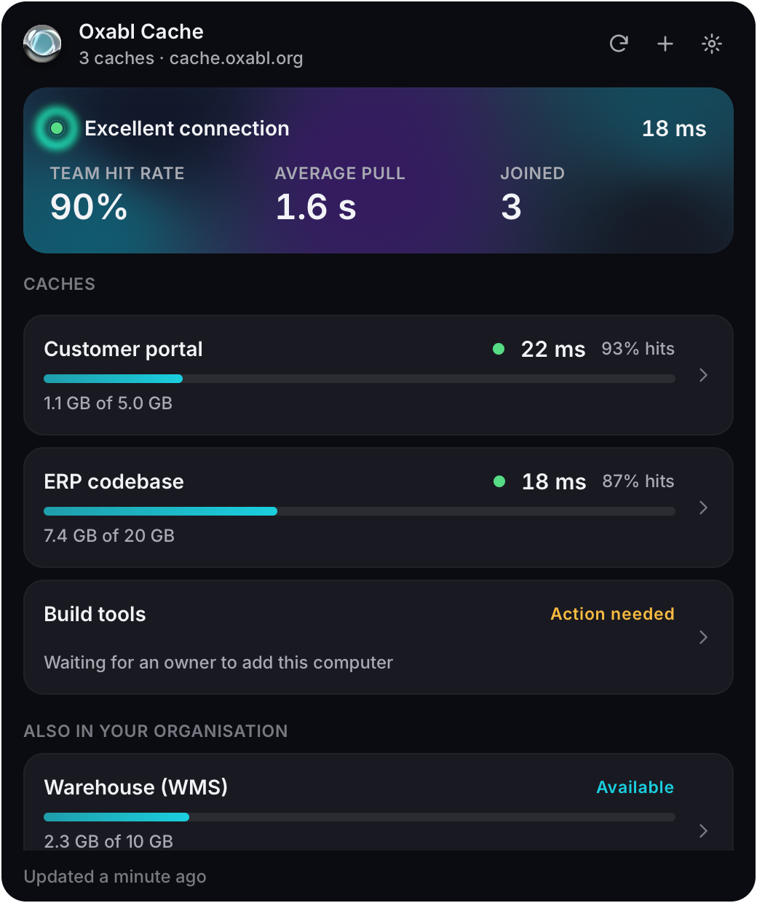
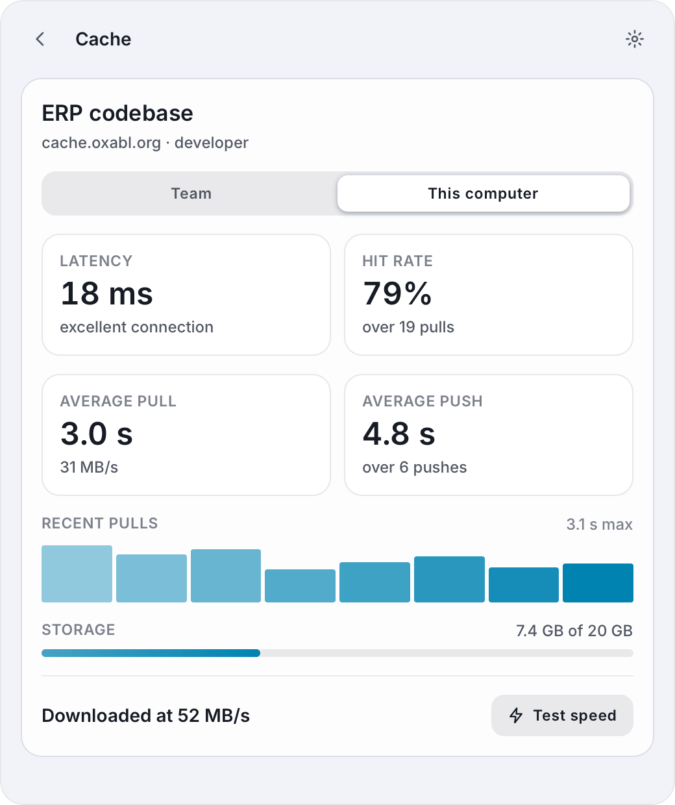

# Oxabl Cache for the desktop

A small window onto the oxabl caches of your organisations. It opens in about a quarter of a
second, shows each cache's size, your round trip to it, and how long pulls and pushes take and
how often a build hits, for the whole team and for this computer, and goes away with Escape.
Joining a cache takes three steps and no command line.

 

## What it shows

- **Home.** Every cache joined on this computer: its size against its quota, the round trip,
  the team's hit rate. A summary on top: the connection, the team's hit rate over every cache and
  the average pull. Caches of the same organisations that you can see but have not joined here
  are listed below them.
- **A cache.** Latency, hit rate, average pull and push, for the team or for this computer, the
  recent pulls as a chart, the storage, and a speed test that fetches and verifies a few entries
  as a build does.
- **Settings.** Light, dark or the desktop's choice; the liquid metal and motion on or off; the
  identity passphrase to copy into a password manager; signing out and removing caches.

The team's numbers come from every member's builds: each fetch and store seals a report under
the cache's key and shares it through the server, which cannot read it (docs/security.md,
"Telemetry"). This computer's numbers come from its own journal. Neither ever slows a build.

## Joining

1. **Paste the invite** an owner sent you (`oxabl-cache invite` prints one).
2. **Sign in.** The window shows a code and opens your organisation's sign-in page. When the
   invite names no sign-in, or you press **Use an access token instead**, paste an access token
   from your organisation's administrator. The window checks that it reaches the cache and keeps
   it in the keyring, never in a file. **Sign out** in Settings forgets it; only the
   administrator can revoke it. The window skips this step when the computer already has a
   credential for the organisation: a sign-in, a kept token, or `OXABL_CACHE_TOKEN`.
3. **Ask to be added.** Copy the request and send it to an owner, who runs it once. The window
   notices by itself and says "You're in".

The window makes this computer's identity on the way, with a random passphrase kept in the
keyring (the Secret Service). Copy the passphrase into your password manager when it offers:
with it, a wiped keyring is one paste away. An identity belongs to one computer; a new computer
joins again and gets its own.

## Keys

| Key | Does |
| --- | --- |
| Escape | Back; from home, closes the window |
| Ctrl R | Refresh |
| Ctrl N | Join a cache |
| Ctrl , | Settings |

## Install

From a release, unpack `oxabl-cache-desktop-<version>-x86_64-linux.tar.gz` and run its
`install.sh`, which installs into `~/.local` (or `PREFIX`) with a launcher entry. The binary needs
glibc 2.34 or newer, a Vulkan driver, and Wayland or X11. On tiling window managers (Hyprland,
sway, niri, i3) the window opens floating and stays resizable. A second launch brings the open
window forward.

`OXABL_CACHE_TOKEN`, `OXABL_CACHE_IDENTITY` and `OXABL_CACHE_CA_FILE` work as they do for the
command line.

## Development

This directory is its own Cargo workspace, so the GPU stack never builds with the server. From the
repository root, in the devshell:

```sh
cargo run --manifest-path desktop/Cargo.toml                  # the window
cargo test --manifest-path desktop/Cargo.toml                 # the acceptance tests
cargo clippy --manifest-path desktop/Cargo.toml --all-targets -- -D warnings
desktop/scripts/previews.sh                                   # every scene to target/previews/*.png
desktop/scripts/package.sh                                    # the release tarball in target/dist/
```

- **Previews.** `--list-scenes` names the example states; `--snap out.png --scene detail --at 2.5`
  renders one without a display, through Mesa's lavapipe from the devshell. A run without
  `--scene` renders the state the last real run left (`desktop-snapshot.json` in the state
  directory).
- **Acceptance tests** (`tests/acceptance`) drive the window as a person does, pressing and
  pasting into it and reading what it shows, against the real server, owners and CI machines made
  with the client library, the fake identity provider of `tests/e2e` (inside a network namespace,
  as the command line's sign-in tests are) and a private Secret Service. The tests never touch
  your own keyring or session bus.
- **Startup.** `--snap x.png --at 0 --first-pixels` prints the time from process start to the
  first pixels. The first frames draw without effects; the effects start 0.4 s in, so their
  pipelines never hold the window back. They settle eight seconds after the last change, and an
  idle window draws nothing.
- Built on [Rune](https://github.com/anomalyco/rune), pinned to a `dev` revision in `Cargo.toml`.
